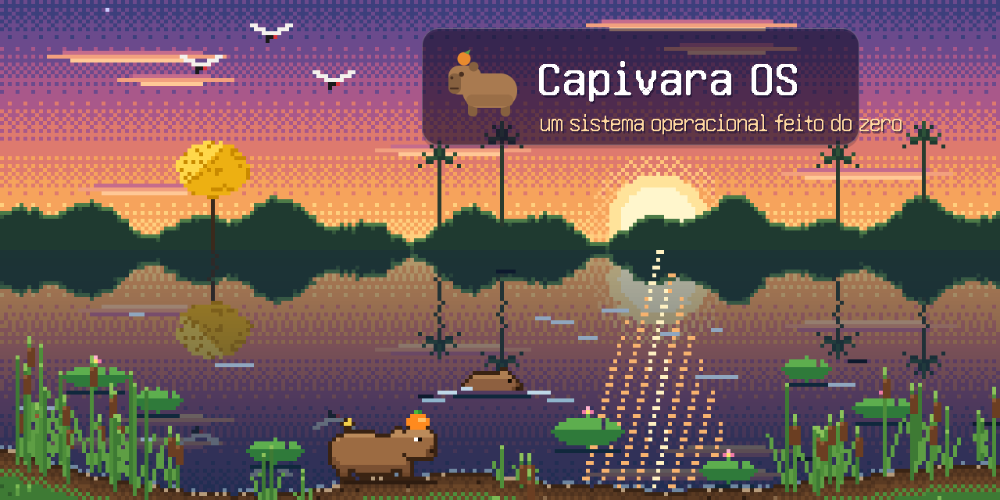
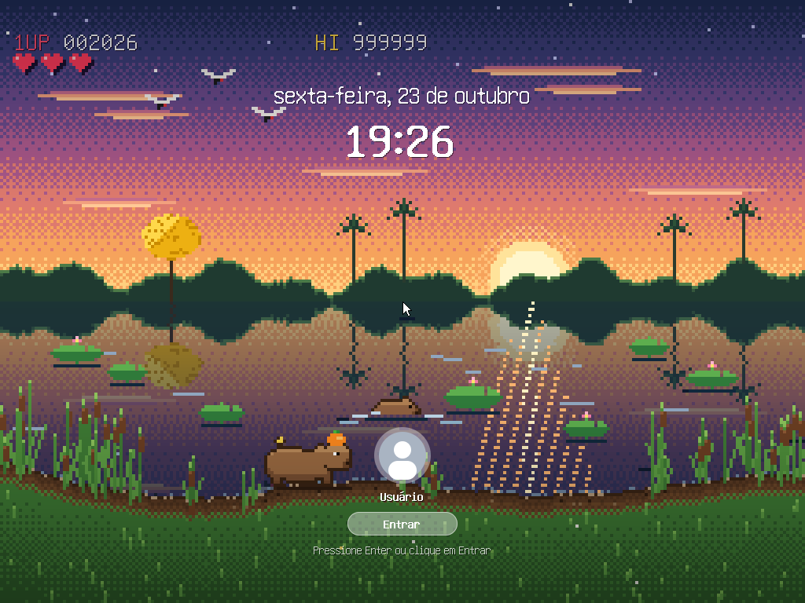
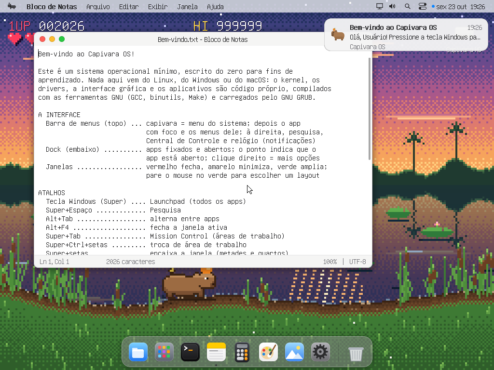
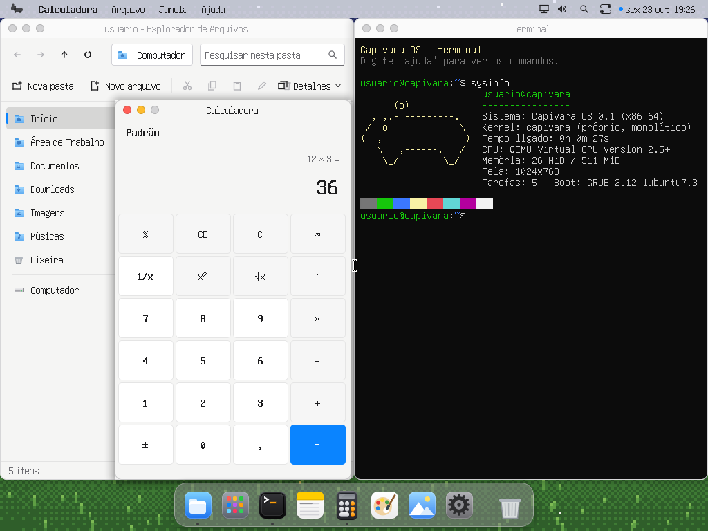
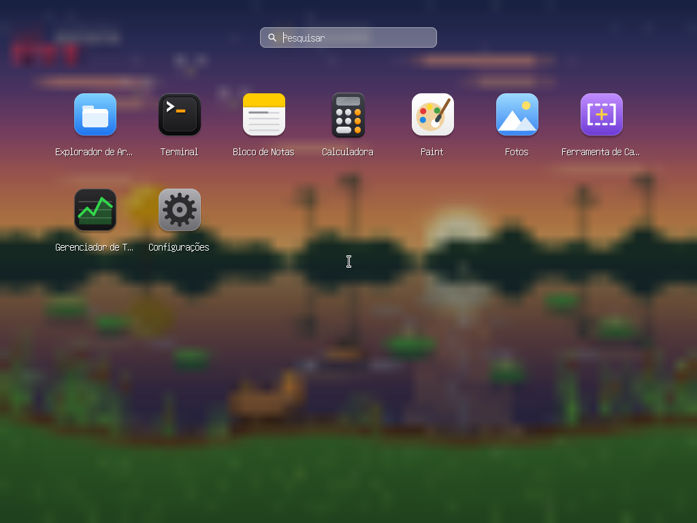
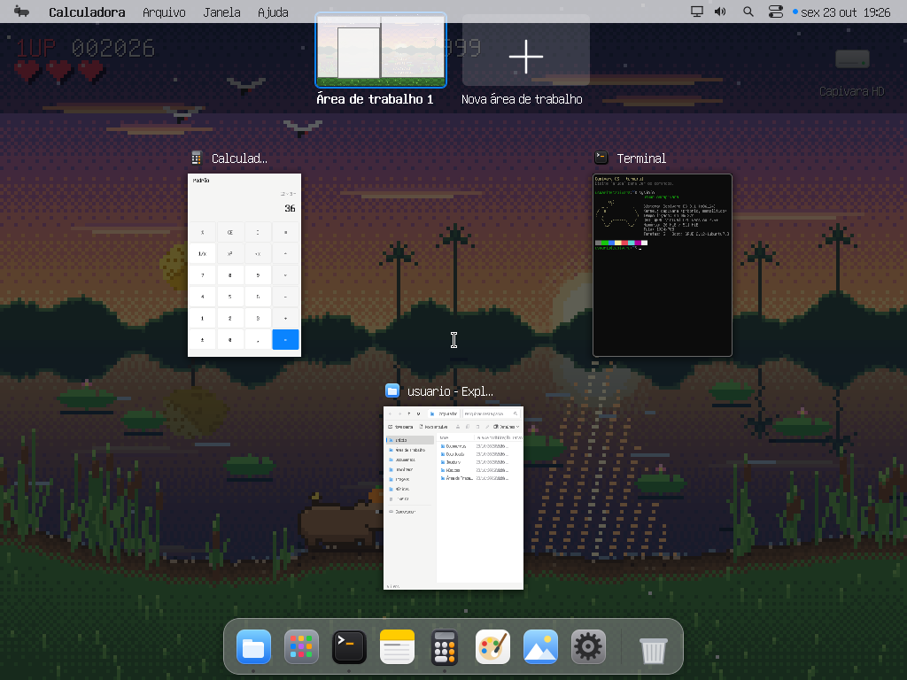
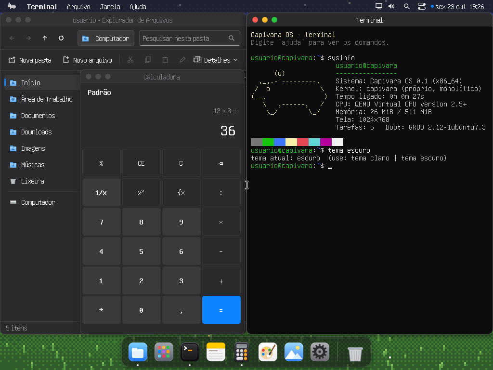
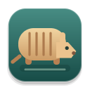
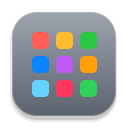

<div align="center">



**Um sistema operacional de 64 bits escrito do zero, para aprender como um computador funciona por dentro.**<br>
Com o nome do maior roedor do mundo, bicho bem brasileiro. 🍊

[](https://github.com/AlefRP/capivara_os/actions/workflows/ci.yml)


[🚀 Começar](#comecando) ·
[🧭 Guia de uso](docs/guia-de-uso.md) ·
[🏗️ Arquitetura](docs/arquitetura.md) ·
[💾 Pendrive](docs/pendrive.md) ·
[📚 Documentação](docs/README.md)

</div>

---

## 🍊 O que é

O Capivara OS é um sistema operacional **mínimo e didático**. Ele tem kernel
próprio de 64 bits, drivers, interface gráfica com **visual no estilo do macOS
e recursos do Windows**, aplicativos nativos e um motor SQL educacional.
O código em C e assembly é comentado em português.

- 🌱 **Escrito do zero.** Não é baseado em Linux nem em nenhum outro sistema:
  o kernel, os drivers, a interface e os apps são código próprio.
- 🐃 **Ferramentas GNU.** É compilado com GCC + binutils (compilador cruzado
  `x86_64-elf`) e GNU Make, dá boot pelo GNU GRUB e usa a fonte GNU Unifont.
- 🧼 **Clean room.** Conceitos do Unix e convenções visuais conhecidas foram
  primeiro descritos em [especificações próprias](docs/spec/) e só depois
  implementados, sem copiar código, ícones ou imagens de ninguém. Veja
  [o processo](docs/clean-room.md).
- 🎨 **Arte feita em código.** Todos os ícones e o papel de parede da capivara
  são desenhados por código. As imagens deste README também: foram geradas
  pelo próprio código gráfico do sistema (`make arte`).

## 📸 Telas

| | |
|:-:|:-:|
|  |  |
| **Tela de bloqueio**: relógio, senha opcional | **Área de trabalho**: barra de menus global, Dock e notificações |
|  |  |
| **Aplicativos** encaixados lado a lado (Super+setas) | **Launchpad** (tecla Super) |
|  |  |
| **Mission Control** e áreas de trabalho virtuais | **Tema escuro** (`tema escuro` no Terminal) |

## 🧰 Aplicativos

| | Aplicativo | O que faz |
|:-:|---|---|
|  | **Explorador de Arquivos** | navega nas pastas, cria, renomeia, copia e apaga; Lixeira e arquivos ocultos |
|  | **Terminal** | uns 45 comandos: `ls`, `cd`, `cat`, `tree`, `ps`, `kill`, `sysinfo`, `dmesg`, `som`, os laboratórios do OSTEP... |
|  | **Estudos** | guia para estudar o livro [OSTEP](docs/ostep.md) com o Capivara: capítulos, código e experimentos, incluindo produtores/consumidores com métricas e verificação de integridade |
|  | **Toca · Tatu DB** | [cliente SQL próprio](docs/tatu.md), com editor, tabelas, grade de resultados e transações; arquivos em RAM |
|  | **Bloco de Notas** | editor de texto UTF-8, com abrir e salvar |
|  | **Calculadora** | calculadora padrão, com vírgula decimal |
|  | **Paint** | pincel, borracha e paleta; abre e salva BMP |
|  | **Fotos** | visualizador de imagens com zoom |
|  | **Ferramenta de Captura** | tela inteira (Print Screen) ou recorte (Super+Shift+S) |
|  | **Gerenciador de Tarefas** | tarefas, uso de CPU e memória, finalizar tarefa |
|  | **Configurações** | tema, cor de destaque, papel de parede, conta e senha, teclado |
|  | **Launchpad** | todos os aplicativos e a pesquisa |
|  | **Lixeira** | restaura ou apaga de vez o que foi excluído |

## ✨ O que já funciona

| Área | Recursos |
|---|---|
| 🥾 Boot | GRUB 2 (BIOS e UEFI), Multiboot2, modo longo de 64 bits, kernel na metade superior |
| 🧠 Memória | alocador físico (bitmap), paginação de 4 níveis, *physmap*, heap `kmalloc` |
| ⚙️ CPU | GDT/TSS, IDT, exceções com tela de erro e pilha de chamadas, SSE com FXSAVE por tarefa |
| 🔀 Tarefas | escalonador preemptivo round-robin (1 kHz), sleep, mutex, semáforos bloqueantes, join, filas de eventos, finalizar tarefa |
| 🔌 Drivers | serial, PIT, PIC, PS/2 (teclado ABNT2/EUA com acentos, mouse com roda), RTC, PCI, ACPI (desligar), reiniciar, som AC'97 (48 kHz por DMA) |
| 🖥️ Máquinas virtuais | mouse absoluto no QEMU (vmmouse) e no VirtualBox (VMMDev), sem precisar "capturar" o cursor |
| 📁 Arquivos | ramfs com pastas e arquivos, initrd em tar carregado pelo GRUB, Lixeira com restauração, imagens BMP |
| 🍎 Visual (estilo macOS) | barra de menus global, Dock com ampliação, botões vermelho/amarelo/verde, Launchpad, Pesquisa, Central de Controle, tema claro/escuro, 6 papéis de parede |
| 🪟 Recursos (estilo Windows) | layouts de encaixe, Super+setas, Alt+Tab, áreas de trabalho virtuais, notificações, captura de tela, histórico da área de transferência, Gerenciador de Tarefas |
| 🔒 Sessão | tela de bloqueio com senha opcional (guardada como hash com sal) |

<a id="comecando"></a>

## 🚀 Começando

Compila no **Windows, no Linux e no macOS**. O caminho mais simples só precisa
do **Docker** (ou do Podman): as ferramentas GNU ficam num container, que na
primeira vez compila o GCC cruzado (uns 10 minutos). Num Linux também dá para
compilar direto com os pacotes da distribuição. Veja
[docs/compilar.md](docs/compilar.md).

**🪟 Windows** (PowerShell):

```powershell
.\build.ps1          # gera build\capivara.iso
.\build.ps1 vbox     # compila e abre no VirtualBox (cria a VM "Capivara OS" se não existir)
.\build.ps1 qemu     # compila e abre no QEMU
.\build.ps1 test     # testes automáticos sem tela; screenshots em build\test\
```

**🐧 Linux, 🍏 macOS e WSL:**

```sh
sh build.sh          # gera build/capivara.iso (com as ferramentas do sistema ou num container)
sh build.sh run      # compila e abre no QEMU (run-uefi: com firmware UEFI)
sh build.sh test     # testes automáticos sem tela
sh build.sh doctor   # mostra quais ferramentas foram encontradas
```

O sistema começa na **tela de bloqueio**: pressione Enter. Não há senha até você
definir uma em Configurações › Contas. No Terminal, digite `ajuda`. O
[guia de uso](docs/guia-de-uso.md) mostra o resto.

A ISO também funciona em VMware e Hyper-V (geração 1).

### 💾 Pendrive bootável

A ISO é **híbrida**: gravada num pendrive, dá boot num PC de verdade por BIOS
ou por UEFI. Para gravar, use `sh build.sh usb` no Linux/macOS, ou o Rufus (em
modo DD) ou o balenaEtcher no Windows. Desligue o Secure Boot antes de dar
boot. O sistema roda inteiro na RAM e não mexe no disco do computador. Veja
[docs/pendrive.md](docs/pendrive.md) para saber o que funciona em hardware real.

## ⌨️ Atalhos

| Atalho | Ação |
|---|---|
| Super (tecla Windows) | Launchpad |
| Super+Espaço | Pesquisa |
| Alt+Tab / Alt+F4 | alternar / fechar janela |
| Super+Tab | Mission Control (áreas de trabalho) |
| Super+Ctrl+←/→, Super+Ctrl+D | trocar / criar área de trabalho |
| Super+setas, Super+Z | encaixar (metades, quartos) / layouts |
| Super+D, Super+E, Super+T | área de trabalho, Explorador, Terminal |
| Super+L, Super+V | bloquear / histórico da área de transferência |
| Print Screen, Super+Shift+S | captura da tela / recorte |
| Ctrl+Shift+Esc | Gerenciador de Tarefas |

## 🗺️ Mapa do código

```text
kernel/
  arch/x86_64/   boot.S (entrada e modo 64 bits), isr.S (interrupções), gdt, idt, pic, pit, cpu
  boot/          leitura das informações do GRUB (Multiboot2)
  mm/            pmm (memória física), vmm (paginação), heap (kmalloc)
  sched/         task (escalonador, mutex), event (filas de eventos)
  dev/           serial, ps2, keyboard, mouse, rtc, pci, power (ACPI), vbox, input, ac97 (som)
  fs/            vfs (ramfs + initrd tar)
  tatu/          motor SQL nativo: parser, plano, operadores, índices e transações
  gui/           gfx (desenho), font, icons, theme, wm (compositor), ui (componentes), bmp, wallpaper
  apps/          shell (barra de menus, Dock, Launchpad...), explorer, terminal, notepad,
                 calc, paint, photos, taskmgr, settings, session, notify, trash,
                 estudos (guia do OSTEP), ostep (os laboratórios do Terminal)
  main.c         kmain: a ordem de inicialização de tudo
docs/            guias, arquitetura, processo clean room e especificações
rootfs/          arquivos que vão para o initrd (aparecem em /home/usuario), com o guia do OSTEP
tests/           roteiros de teste automático (QEMU sem tela)
tools/           fonte, initrd, testes no QEMU e o gerador das imagens da documentação
build.sh         build no Linux/macOS/WSL (build.ps1: o mesmo no PowerShell)
```

Por onde começar a ler o código, e como as peças se encaixam, está em
[docs/arquitetura.md](docs/arquitetura.md).

## 📚 Documentação

| | |
|---|---|
| 🧭 [Guia de uso](docs/guia-de-uso.md) | a interface, os aplicativos e todos os comandos do Terminal |
| 🏗️ [Arquitetura](docs/arquitetura.md) | do boot ao pixel na tela: como o sistema funciona por dentro |
| 🛠️ [Como compilar](docs/compilar.md) | Windows, Linux e macOS; com container ou nativo |
| 💾 [Pendrive bootável](docs/pendrive.md) | gravar, dar boot e o que esperar em hardware real |
| 🧼 [Clean room](docs/clean-room.md) | como o sistema foi feito sem copiar código de ninguém |
| 🧩 [Programas extras](docs/extras.md) | programas de fora do repositório que entram só no seu build |
| 📚 [Estudando o OSTEP](docs/ostep.md) | o livro *Operating Systems: Three Easy Pieces* capítulo por capítulo, no código e nos laboratórios |
| 📐 [Especificações](docs/spec/) | boot e memória, interrupções e tarefas, interface gráfica |

## 🤖 Testes automáticos e Claude Code

- **GitHub Actions:** a cada push, a ISO é compilada em Ubuntu, Fedora e Arch.
  Depois, ela dá boot no QEMU como CD e como pendrive, por BIOS e por UEFI, e os
  roteiros da interface rodam sozinhos. As capturas de tela ficam nos
  artefatos de cada execução. Cada commit em `main` que passa no CI vira uma
  versão `vX.Y.N` (N é o número do commit), com a tag e a ISO pronta numa
  [Release](https://github.com/AlefRP/capivara_os/releases).
- **Claude Code:** o [CLAUDE.md](CLAUDE.md) traz as regras do projeto (clean
  room, sem libc, sem float no núcleo...). Em [.claude/](.claude/) há o
  agente `testador-qemu`, que testa e olha as telas, e as skills
  `testar-no-qemu`, `novo-aplicativo`, `desenhar-icone` e `publicar-versao`.

<a id="roteiro"></a>

## 🛤️ Roteiro

1. **Modo usuário**: processos no anel 3, cada um com seu espaço de
   endereçamento, chamadas de sistema (`int 0x80`/`syscall`), carregador ELF e
   uma libc mínima. Os aplicativos saem do kernel.
2. **Disco**: driver ATA/AHCI e um sistema de arquivos persistente (FAT32 ou ext2).
3. **Hardware real**: APIC/IOAPIC, USB (XHCI) para teclado e mouse, várias CPUs.
4. **Rede**: placa e1000/virtio-net, ARP, IP, UDP, TCP, DHCP.
5. **Interface**: fonte vetorial (rasterizador TrueType próprio), imagens PNG,
   som em hardware real (Intel HD Audio).

## 📜 Licenças de terceiros

- **GNU Unifont**: GPLv2+ com exceção para embutir fontes, ou SIL OFL 1.1.
  Apenas um subconjunto (Latin-1, molduras e símbolos) é incluído em
  `kernel/gui/font/unifont-subset.hex`.
- **GRUB, GCC e binutils** são usados como ferramentas; nada do código deles é
  incorporado ao kernel.

## 📄 Licença

Este projeto está licenciado sob a [MIT License](LICENSE).

<div align="center">
<br>
<br>
<sub>Feito com calma, como uma capivara na beira do rio.</sub>
</div>
