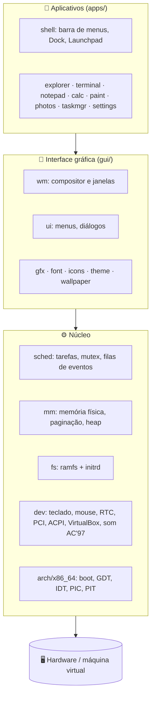
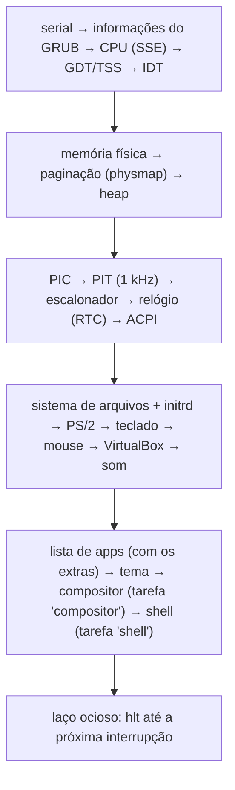
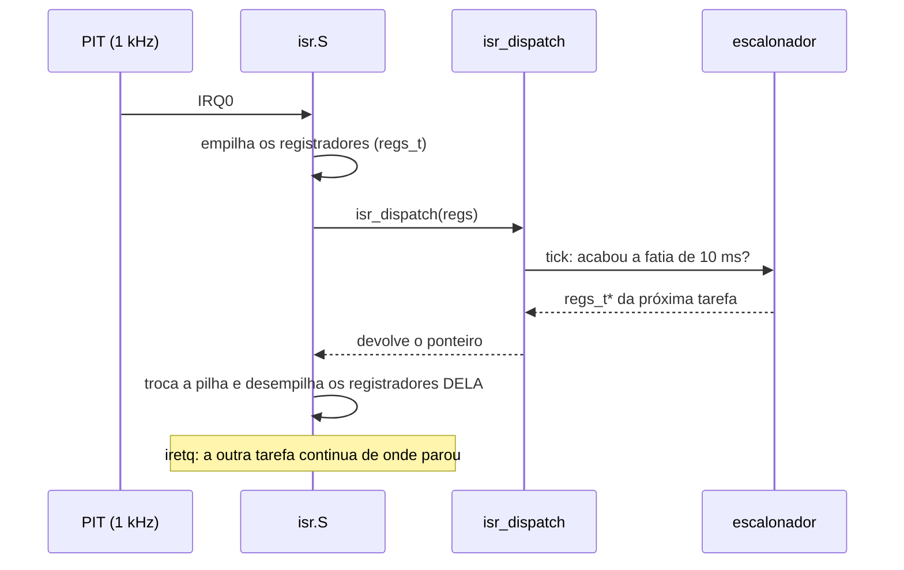
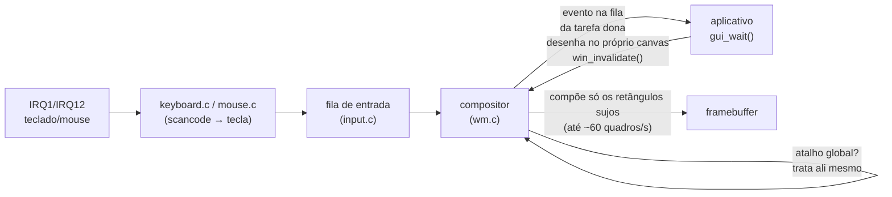

# 🏗️ Arquitetura

Como o Capivara OS funciona por dentro, do boot até o pixel na tela. Os
detalhes de cada parte estão nas [especificações](spec/). Aqui fica o mapa
geral.

## 🧱 Camadas

Hoje tudo roda no **anel 0** (modo kernel): os aplicativos são tarefas do
próprio kernel. Separar os aplicativos em processos de usuário é o primeiro
item do [roteiro](../README.md#roteiro).

| Parte | Linhas | Pasta |
|---|--:|---|
| Aplicativos | ~5 600 | `kernel/apps/` |
| Interface gráfica | ~4 900 | `kernel/gui/` |
| Drivers | ~1 100 | `kernel/dev/` |
| Arquitetura x86_64 (boot, interrupções) | ~650 | `kernel/arch/x86_64/` |
| Tarefas e eventos | ~560 | `kernel/sched/` |
| Memória | ~420 | `kernel/mm/` |
| Biblioteca (strings, printf, UTF-8) | ~400 | `kernel/lib/` |
| Arquivos | ~390 | `kernel/fs/` |

## 🥾 Do botão de ligar ao `kmain`

1. O firmware carrega o **GRUB**, que lê o `kernel.elf` e o `initrd.tar` da
   ISO. Ele também prepara um framebuffer gráfico e entra no kernel em modo
   protegido de 32 bits, com as informações de boot em `EBX`.
2. O **`boot.S`** monta tabelas de página mínimas, liga o modo longo (64 bits) e
   salta para `kmain`, já no endereço alto onde o kernel foi linkado.
3. O **`kmain`** ([main.c](../kernel/main.c)) liga tudo, nesta ordem:

## 🧠 Memória

| Endereço virtual | O que tem lá |
|---|---|
| `0xFFFFFFFF80000000` + físico | o kernel (carregado no endereço físico 1 MiB) |
| `0xFFFF800000000000` + físico | *physmap*: toda a RAM, o framebuffer e o ACPI, mapeados em páginas de 2 MiB |
| `0xFFFFA00000000000` em diante | heap do kernel (`kmalloc`), que cresce página a página |

- **Memória física** ([pmm.c](../kernel/mm/pmm.c)): um *bitmap* com um bit por
  página de 4 KiB, montado a partir do mapa de memória que o GRUB entrega.
- **Paginação** ([vmm.c](../kernel/mm/vmm.c)): tabelas de 4 níveis (PML4 → PDPT
  → PD → PT).
- **Heap** ([heap.c](../kernel/mm/heap.c)): *first-fit* com junção de blocos
  vizinhos. Cada bloco anota a tarefa dona, e é daí que o Gerenciador de
  Tarefas tira a coluna Memória.

## ⏱️ Interrupções e troca de tarefa

O truque está em `isr_dispatch` **devolver** um ponteiro de registradores. Se
devolver o de outra tarefa, o *stub* em assembly restaura os registradores
dessa outra tarefa, e a troca de contexto acontece aí. O estado SSE (usado
pelas contas de antisserrilhado da interface) é salvo por tarefa com
`FXSAVE`/`FXRSTOR`. O código do núcleo é compilado sem SSE, porque roda dentro
das interrupções.

## 🖱️ O caminho de um clique até a tela

- Cada aplicativo é um laço **espera evento → trata → redesenha**, como o
  modelo de mensagens do Windows.
- Cada janela tem o próprio *canvas*. O compositor junta tudo num *back buffer*
  e copia para o framebuffer só o que mudou. Ele também pula as áreas cobertas
  por janelas opacas.
- Molduras, botões vermelho/amarelo/verde, sombras, Mission Control, Alt+Tab e
  layouts de encaixe são desenhados pelo compositor, e não pelos aplicativos.

## 🔊 Som

O driver [ac97.c](../kernel/dev/ac97.c) fala com a placa AC'97 (VirtualBox e
QEMU) por duas faixas de portas de E/S: o mixer (volumes) e o *bus master*,
que copia o som da RAM por DMA. A saída segue uma lista circular de 32
descritores, cada um apontando para ~10,7 ms de som na memória física. Quem
toca som chama `audio_write()`, que enche os pedaços à frente do que a placa
está tocando, e consulta `audio_queued()` para manter a fila curta. Não há
interrupção: um jogo, por exemplo, escreve a cada quadro e segue o relógio
da placa ([dev/audio.h](../kernel/dev/audio.h)).

## 📁 Arquivos

O sistema de arquivos ([vfs.c](../kernel/fs/vfs.c)) é um *ramfs*: pastas e
arquivos em memória. No boot, o conteúdo de [rootfs/](../rootfs/) chega como
um `initrd.tar` (gerado por [tools/mkinitrd.py](../tools/mkinitrd.py)) que o
GRUB carrega junto com o kernel, e o `vfs_load_initrd` o desempacota.

## 📖 Ordem sugerida de leitura

1. [`arch/x86_64/boot.S`](../kernel/arch/x86_64/boot.S) → [`main.c`](../kernel/main.c):
   do GRUB até a primeira linha em C.
2. [`mm/pmm.c`](../kernel/mm/pmm.c) → [`mm/vmm.c`](../kernel/mm/vmm.c) → [`mm/heap.c`](../kernel/mm/heap.c):
   de "páginas de RAM" até `kmalloc`.
3. [`arch/x86_64/isr.S`](../kernel/arch/x86_64/isr.S) → [`idt.c`](../kernel/arch/x86_64/idt.c) → [`sched/task.c`](../kernel/sched/task.c):
   como uma interrupção vira troca de tarefa.
4. [`dev/keyboard.c`](../kernel/dev/keyboard.c) → [`dev/input.c`](../kernel/dev/input.c) → [`gui/wm.c`](../kernel/gui/wm.c)
   (`handle_key`, `on_button`): o caminho de uma tecla até o aplicativo.
5. [`gui/gfx.c`](../kernel/gui/gfx.c) e [`gui/wm.c`](../kernel/gui/wm.c) (`compose_rect`):
   como a tela é desenhada.
6. Qualquer aplicativo em [`apps/`](../kernel/apps/): todos seguem o laço
   "espera evento → trata → redesenha".
