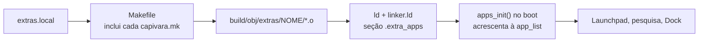

# 🧩 Programas extras (só no seu computador)

Um **extra** é um programa que fica **fora do repositório** e entra no kernel
só quando você compila na sua máquina. Serve para coisas que não podem ser
publicadas, como o port de um jogo comercial feito a partir de um cartucho
seu, ou que você só quer testar sem misturar com o sistema.

O clean room do projeto ([clean-room.md](clean-room.md)) continua valendo: um
extra **nunca** vai para o Git, para o CI nem para as
[Releases](https://github.com/AlefRP/capivara_os/releases). As versões
publicadas são compiladas pelo GitHub Actions, que não tem nenhum extra.

## ▶️ Ligar um extra

1. Crie o arquivo `extras.local` na raiz do projeto, com uma pasta por linha.
   Ele já está no `.gitignore`.

   ```text
   # meus programas extras
   D:\Projetos\meu-jogo
   ```

2. Compile como sempre: `.\build.ps1 vbox`, `sh build.sh` ou `make`. Os
   scripts montam cada pasta dentro do container, em `/extras/0`,
   `/extras/1`... Num Linux com as ferramentas nativas, o `make` lê o
   `extras.local` direto (use caminhos do Linux).
3. O programa aparece no Launchpad e na pesquisa, e também no Dock se ele
   pedir. No log do kernel (serial) aparece `apps: extra 'nome'`.

Para tirar um extra, apague a linha (ou o arquivo) e compile de novo. O
kernel é ligado outra vez sem ele.

Caminhos com espaço não funcionam: o `make` separa a lista por espaços.

## 📦 O que a pasta do extra precisa ter

Um **`capivara.mk`**, que o Makefile do sistema inclui. Os caminhos são
relativos à pasta do extra, que fica em `$(EXTRA_DIR)`:

```make
EXTRA_NAME  := meujogo                      # pasta dos objetos: build/obj/extras/meujogo/
EXTRA_FILES := src/jogo.c capivara/app.c    # fontes .c, compilados como os apps (com SSE)
EXTRA_FLAGS := -I$(EXTRA_DIR)/capivara/include -I$(EXTRA_DIR)/src
```

E um arquivo C que **registra o app** com `EXTRA_APP` (de
[apps/apps.h](../kernel/apps/apps.h)). O resto é igual a um app do sistema:
janela, laço de eventos e desenho (veja a skill `novo-aplicativo`).

```c
#include "apps/apps.h"
#include "gui/ui.h"

static void jogo_main(void *arg) {
    /* win_create, gui_poll/gui_wait, win_canvas, win_invalidate... */
}

extern const icon_image_t icone_do_jogo;      /* opcional, veja abaixo */

EXTRA_APP(jogo_app,
          /*      id      nome       descrição      ícone      função     no Dock? */
          .app = { "jogo", "Meu Jogo", "Um jogo meu", ICON_GAME, jogo_main, true },
          .image = &icone_do_jogo,            /* opcional: ícone de imagem */
          .desktop = true);                   /* opcional: atalho na área de trabalho */
```

**Ícone próprio.** Os ícones do sistema são desenhados em código
([icons.c](../kernel/gui/icons.c)), mas um extra pode trazer a arte dele: um
`icon_image_t` com uma imagem quadrada ARGB de 32 bits (128×128 é um bom
tamanho). No boot, `icon_from_image` dá um número de ícone para ela, e o
sistema reduz a imagem com média de área para cada lugar (lista, Dock,
Launchpad, área de trabalho). Sem `.image`, vale o ícone do `.app`. Para
achar o número dentro do programa (para a janela, por exemplo), use
`app_find("jogo")->icon`.

**Atalho na área de trabalho.** Com `.desktop = true`, o boot cria
`Meu Jogo.app` em Área de Trabalho. Um arquivo `.app` é um atalho: guarda o id
do app, aparece com o ícone dele e abre o app no clique duplo. Dá para
apagá-lo como qualquer arquivo.

Um extra pode usar qualquer função do kernel: `audio_write` e
`audio_queued` ([dev/audio.h](../kernel/dev/audio.h)) para som, `timer_ms`
e `task_sleep` para o ritmo, os eventos `EV_KEY_DOWN`/`EV_KEY_UP` para o
teclado.

**Não há biblioteca C.** Se o código do extra inclui `<string.h>`, ponha na
pasta dele um `include/string.h` com `#include "lib/string.h"` e passe essa
pasta em `EXTRA_FLAGS`.

## ⚙️ Como funciona por dentro



- **Compilação:** para cada pasta, o [Makefile](../Makefile) inclui o
  `capivara.mk` e cria as regras dos fontes, com as mesmas opções dos apps
  mais as `EXTRA_FLAGS`. A lista de extras fica anotada em
  `build/extras.lista`. Se ela muda, o kernel é ligado de novo.
- **Registro:** `EXTRA_APP` põe um `app_info_t` na seção `.extra_apps` do
  objeto. O [linker.ld](../kernel/linker.ld) junta essas entradas, uma atrás
  da outra, entre `__extra_apps_start` e `__extra_apps_end`, e o
  `apps_init()` ([apps.c](../kernel/apps/apps.c)) as acrescenta à lista de
  apps no boot.
- Por isso o código do sistema não conhece nenhum extra: não há `#ifdef` nem
  nome de programa externo no kernel.

## 🚫 Regras

- Não versione o `extras.local` nem o código de um extra, e não use extras
  nos roteiros de `tests/`, que rodam no CI.
- A ISO que você compila com extras é só sua: não publique.
