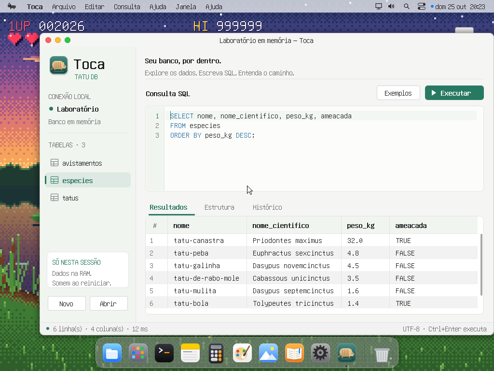

# 🦔 Tatu DB e Toca

O **Toca** é o cliente gráfico próprio do Tatu DB no Capivara OS. Abra pela
Pesquisa (Super+Espaço, `Toca`, Enter), pelo Launchpad ou com `abrir toca` no
Terminal. Arquivos `.tatu` abrem no Toca pelo Explorador.

O motor original está em `D:\Projetos\tatu_db` e é escrito em Python. Aqui
ele foi reimplementado em C, com autorização do autor dos dois projetos,
usando o heap, as tarefas, os mutexes e o VFS do Capivara. Não é necessário
instalar Python, executar um servidor ou conectar a um banco no Windows.



## Usar o cliente

O Toca começa em um banco de demonstração em memória, com espécies de tatu,
tatus e avistamentos. Os dados são didáticos; não são uma base científica.

- A lateral lista tabelas. Selecione uma para consultar dados e inspecionar
  suas colunas e a quantidade de índices.
- Escreva SQL no editor e use **Executar**, **Ctrl+Enter** ou **F5**.
- O resultado aparece em uma grade. Use a rolagem para explorar os dados.
- **Novo banco** e **Abrir banco** trabalham com arquivos `.tatu`.
- O menu Arquivo permite abrir/salvar consultas SQL e exportar resultados.

As alterações confirmadas são gravadas automaticamente no arquivo do banco.
`BEGIN`, `COMMIT` e `ROLLBACK` permitem experimentar transações. Fechar um
banco com uma transação aberta desfaz as alterações ainda não confirmadas.
Um mesmo arquivo não pode ser aberto simultaneamente por dois clientes;
feche a primeira conexão antes de reabri-lo.

**O sistema de arquivos atual é RAM.** Salvar um `.tatu` permite fechar e
reabrir o cliente durante a sessão, mas tudo criado ou alterado desaparece
quando o SO reinicia. O motor ainda não oferece durabilidade em disco,
WAL, recuperação após falta de energia ou concorrência entre processos.

## Terminal

Digite `tatu` para abrir um banco em memória ou `tatu arquivo.tatu` para
abrir/criar um banco na pasta atual. Termine o SQL com `;`; um comando pode
ocupar várias linhas. **Ctrl+C** descarta a entrada incompleta.

| Comando | Ação |
|---|---|
| `.help` | ajuda do shell SQL |
| `.tables` | tabelas, colunas, linhas e índices |
| `.schema [tabela]` | CREATE TABLE e CREATE INDEX |
| `.demo` | cria os dados de exemplo em um banco vazio |
| `.read /caminho/arquivo.sql` | executa um arquivo SQL (até 1 MiB) |
| `.quit` | fecha o banco e volta ao Terminal |
| `tatu teste` (fora do shell SQL) | testes internos do motor |

Exemplo:

```sql
SELECT t.apelido, e.nome AS especie
FROM tatus t LEFT JOIN especies e ON t.especie_id = e.id
ORDER BY t.apelido;

SELECT bioma, COUNT(*) AS vezes
FROM avistamentos
GROUP BY bioma
ORDER BY vezes DESC, bioma;

EXPLAIN SELECT apelido FROM tatus WHERE especie_id = 2;
```

## SQL e formato

O motor implementa `SELECT`, `INSERT`, `UPDATE`, `DELETE`, `CREATE TABLE`,
`DROP TABLE`, `CREATE [UNIQUE] INDEX`, `BEGIN`, `COMMIT`, `ROLLBACK` e
`EXPLAIN`. Há filtros, expressões, funções escalares, agregações,
`INNER/LEFT/CROSS JOIN`, `GROUP BY`, `HAVING`, `ORDER BY`, `DISTINCT`,
`LIMIT` e `OFFSET`, com valores `NULL`, `INTEGER`, `REAL`, `TEXT` e `BOOLEAN`.

Chaves primárias, `NOT NULL`, `UNIQUE`, valores padrão e referências entre
tabelas são verificadas pelo motor. A API C aceita parâmetros `?` como
valores separados do SQL; aplicações não precisam concatenar entradas.

O arquivo `.tatu` usa o JSON do Tatu DB, versão de formato 1. Bancos podem
ser incluídos em `rootfs/` antes de compilar para aparecer no Capivara.
Não há ainda um mecanismo de transferência de arquivos entre o SO e o host
durante a execução. Compatibilidade de formato não significa igualdade
irrestrita: inteiros aqui são de 64 bits, e UPPER/LOWER convertem o alfabeto
latino e Latin-1, preservando outros caracteres.
`ROUND` com precisão fora do intervalo de -22 a 32 casas usa uma aproximação
de ponto flutuante; não há promessa de igualdade numérica irrestrita com
o Python em precisões extremas.

## Código e estudos

| Arquivo | Responsabilidade |
|---|---|
| `kernel/tatu/lexer.c`, `parser.c`, `ast.c` | texto SQL, tokens e árvore sintática |
| `kernel/tatu/expr.c`, `plan.c` | expressões, plano e operadores |
| `kernel/tatu/storage.c`, `json.c` | tabelas, índices hash, diário de desfazer e arquivo |
| `kernel/tatu/exec.c` | execução e API pública, protegida por mutex |
| `kernel/apps/toca.c` | cliente gráfico |
| `kernel/tatu/shell.c` | shell SQL do Terminal |

A ligação com o OSTEP aparece no gerenciamento de memória das arenas, na
exclusão mútua, na representação de arquivos e nas transações. O diário é
um mecanismo de **desfazer em memória**, não um log persistente de
recuperação. Um próximo passo didático é implementar o driver de disco e
a gravação durável antes de estudar recuperação de falhas.

## Verificar

No Linux ou no container de ferramentas:

```sh
sh tools/tatu/test-host.sh
sh tools/tatu/test-storage.sh
sh tools/tatu/test-oom.sh
sh build.sh test tests/tatu.txt --out build/test/tatu
```

Os três primeiros comandos compilam o motor e o VFS reais com
AddressSanitizer e UndefinedBehaviorSanitizer, incluindo arquivos inválidos
e falhas de gravação e de alocação de memória. O último dá boot no QEMU,
executa os testes no Terminal e exercita o cliente nos temas claro e escuro. `tests/toca-ui.txt`
exercita consultas, erros, estrutura, histórico e diálogos.
`tests/toca-layout.txt` gera as capturas dos temas e do tamanho mínimo.

Com o Tatu Python disponível separadamente, `tools/tatu/compat.py` compara
consultas entre os dois motores e testa arquivos JSON nos dois sentidos.
Ele usa `PYTHONPATH` para importar o projeto original, sem incorporá-lo ao
repositório ou ao CI.
